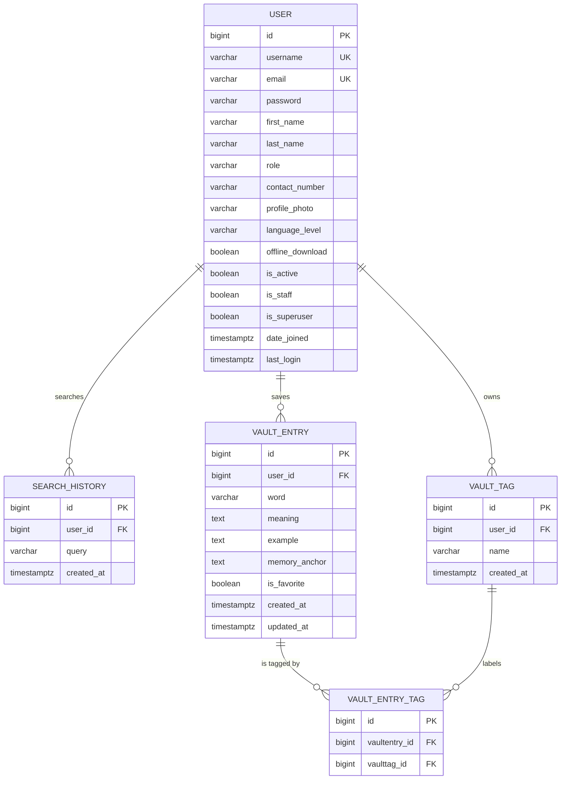

# LexiTrace Entity Relationship Diagram

This document describes the LexiTrace data model for Increment 2: user accounts, search history and the Personal Vault. All tables live in Supabase PostgreSQL. Table names are the ones Django creates.

## Diagram

VaultEntry and VaultTag have a many-to-many relationship. Django stores it in the link table VAULT_ENTRY_TAG.

## Entities

### User (`accounts_user`)

The custom Django user. It extends Django's built-in `AbstractUser`, so passwords are always stored as hashes.

| Field | Type | Key | Notes |
|---|---|---|---|
| id | bigint | PK | Auto-generated |
| username | varchar(150) | Unique | Required; checked case-insensitively at registration |
| email | varchar(254) | Unique | Required; stored in lowercase |
| password | varchar(128) | | Django password hash, never plain text |
| first_name | varchar(150) | | Required at registration |
| last_name | varchar(150) | | Required at registration |
| role | varchar(20) | | `learner` (default) or `admin`; superusers get `admin` |
| contact_number | varchar(20) | | Optional; empty text when not given |
| profile_photo | varchar(100) | | Optional image path, null when not set; JPEG, PNG or WebP, up to 2 MB |
| language_level | varchar(20) | | `beginner`, `intermediate` (default) or `advanced` |
| offline_download | boolean | | Default true |
| is_active, is_staff, is_superuser | boolean | | Django account flags; defaults true, false, false |
| date_joined, last_login | timestamptz | | Set by Django; last_login is null until the first login |

Django's built-in group and permission links are left out of the diagram because LexiTrace does not use them.

### SearchHistory (`accounts_searchhistory`)

The words and phrases a user has searched for, shown as "Recent searches" on the dashboard.

| Field | Type | Key | Notes |
|---|---|---|---|
| id | bigint | PK | Auto-generated |
| user_id | bigint | FK to User | Deleted with the user |
| query | varchar(200) | | 2 to 200 characters, whitespace trimmed |
| created_at | timestamptz | | Set on creation; refreshed when the same query is searched again |

Searches are listed newest first. Only the 20 most recent searches per user are kept.

### VaultEntry (`vault_vaultentry`)

A word the user saved to their Personal Vault.

| Field | Type | Key | Notes |
|---|---|---|---|
| id | bigint | PK | Auto-generated |
| user_id | bigint | FK to User | Deleted with the user |
| word | varchar(60) | Unique per user, case-insensitive | Letters, spaces, hyphens and apostrophes; at least 2 characters; trimmed |
| meaning | text | | Required, up to 1000 characters |
| example | text | | Optional (empty text when not given), up to 500 characters |
| memory_anchor | text | | Optional (empty text when not given), up to 500 characters; the user's own memory aid |
| is_favorite | boolean | | Default false |
| created_at | timestamptz | | Set on creation |
| updated_at | timestamptz | | Updated on every save |

Entries are listed newest first, backed by the index `vault_entry_user_created_idx` on (user_id, created_at descending). The unique constraint `vault_entry_unique_word_per_user` covers (user_id, lower(word)).

### VaultTag (`vault_vaulttag`)

A label the user creates to organise their vault entries.

| Field | Type | Key | Notes |
|---|---|---|---|
| id | bigint | PK | Auto-generated |
| user_id | bigint | FK to User | Deleted with the user |
| name | varchar(30) | Unique per user, case-insensitive | 2 to 30 characters; letters (accents allowed), digits, spaces and hyphens; trimmed, with runs of spaces collapsed to one |
| created_at | timestamptz | | Set on creation |

Tags are listed alphabetically. The unique constraint `vault_tag_unique_name_per_user` covers (user_id, lower(name)).

### VaultEntry-VaultTag link (`vault_vaultentry_tags`)

The many-to-many link between entries and tags, created by Django.

| Field | Type | Key | Notes |
|---|---|---|---|
| id | bigint | PK | Auto-generated |
| vaultentry_id | bigint | FK to VaultEntry | Deleted with the entry |
| vaulttag_id | bigint | FK to VaultTag | Deleted with the tag |

The pair (vaultentry_id, vaulttag_id) is unique, so a tag can be attached to an entry only once.

## Relationships

- **User to SearchHistory:** one to many. A user has zero or more searches; each search belongs to exactly one user.
- **User to VaultEntry:** one to many. A user has zero or more vault entries; each entry belongs to exactly one user.
- **User to VaultTag:** one to many. A user has zero or more tags; each tag belongs to exactly one user.
- **VaultEntry to VaultTag:** many to many, through the link table. An entry can have zero or more tags, and a tag can label zero or more entries.

Deleting a user deletes their searches, vault entries, tags and tag links. Deleting an entry or a tag deletes only its links.

## Business rules

1. **One entry per word per user.** A user cannot save the same word twice, ignoring letter case ("Bank" and "bank" count as the same word). Different users can save the same word. Enforced by the database constraint `vault_entry_unique_word_per_user`.
2. **One tag name per user.** A user cannot have two tags with the same name, ignoring letter case. Different users can use the same tag name. Enforced by the database constraint `vault_tag_unique_name_per_user`.
3. **Tags must belong to the entry's owner.** An entry can only use tags owned by the same user. Enforced in the application by `VaultEntry.set_tags()`.
4. **Learners see only their own records.** A learner can view, add, edit and delete only their own vault entries, tags and searches. Every vault query is filtered by the signed-in user, and another user's record returns a 404 page.
5. **Admins can view and delete, but not edit.** An admin can view and delete any user's vault entries through the moderation pages but cannot create or edit them. Deleting an entry keeps the owner's tags.
6. **At most 5 tags per entry.** An entry can have up to 5 tags. Enforced in the application by the entry form.
